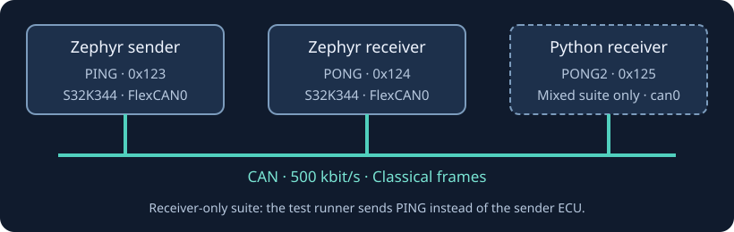

# CAN ping-pong on S32K344

Two Zephyr ECUs exchange PING and PONG frames over Classical CAN. An optional Python ECU replies on its own CAN ID.



## Build the firmware

Install the [tf CLI](https://nebula-platform.dev/docs/getting-started/install-cli).
For Docker builds, install Docker and prepare the toolchain once:

```sh
tf build setup --docker
```

You can instead configure a native Zephyr toolchain with `tf build setup --native`.
Neither build mode needs a cloud login. Docker mode downloads the TrueFidelity
Zephyr build environment.

Run from this directory:

```sh
./build.sh release
```

The build creates `sender/build/release/zephyr/zephyr.elf` and `receiver/build/release/zephyr/zephyr.elf`. Use `./build.sh debug` for debug builds. The script calls `tf build` once for
each ECU. Extra arguments are passed through, for example
`./build.sh release --plan` to inspect the commands, or
`./build.sh release --mode docker` to select Docker explicitly.
Set `TF_CLI=/path/to/tf` to use a CLI outside your PATH.

## Run automated tests

[Run the ping-pong tests](tests/README.md) covers package preparation, CLI execution, and CI results. The test package defines complete topologies; you do not need to create them in the portal.

The examples include receiver-only input checks, a firmware-pair suite with continuation and reset, and a mixed firmware/Python suite. See [verification and current runtime limits](tests/verification.md) before scheduling the full suites in CI.

## Open the demo in the portal

Create the topology in the portal:

1. Upload `pingpong.dbc`.
2. Create a CAN bus at 500 kbit/s and attach the DBC.
3. Add sender and receiver ECUs with the S32K344 board and their matching ELF files.
4. Connect both ECUs to the CAN bus through FlexCAN0.
5. Start the topology and open its traffic view.

For the legacy behavioral model, add a script ECU with `receiver-py/main.py`. Coordinated CLI tests use [tests/python/receiver.py](tests/python/receiver.py) instead. These entrypoints use different SDKs and clock sources.

## Frame format

The firmware and coordinated test receiver use standard identifiers and an eight-byte payload. The PONG2 format below applies to `tests/python/receiver.py`.

| Message | CAN ID | Sender |
| --- | --- | --- |
| PING | `0x123` | Zephyr sender |
| PONG | `0x124` | Zephyr receiver |
| PONG2 | `0x125` | Python receiver |

| Bytes | PING | PONG and PONG2 |
| --- | --- | --- |
| 0 through 3 | ASCII `PING` | ASCII `PONG` |
| 4 | Sequence counter, 0 through 255 | Echo of the received counter |
| 5 | Signal strength, 50 through 100 | Processing time in milliseconds |
| 6 through 7 | Milliseconds since sender start | Estimated round-trip time in milliseconds |

Two-byte fields use little-endian order. The DBC describes bytes 4 through 7. The firmware also requires the ASCII header.

The legacy `receiver-py/main.py` sends DBC signals without setting the ASCII header. Its PONG2 payload is not byte-identical to the coordinated test receiver's payload.

The sender waits up to 50 ms for PONG, then sleeps for one second. Its period includes that acknowledgment wait. Each valid PING produces a firmware PONG; the optional Python receiver produces PONG2 as well.

## Source files

- [sender/main.c](sender/main.c): PING loop and PONG handling.
- [receiver/main.c](receiver/main.c): PING validation and queued PONG work.
- [receiver-py/main.py](receiver-py/main.py): Legacy portal behavioral model.
- [tests/python/receiver.py](tests/python/receiver.py): Coordinated ECU-time behavioral model.
- [tests/reference.md](tests/reference.md): Test assertions, suite lifecycle, and recording settings.
